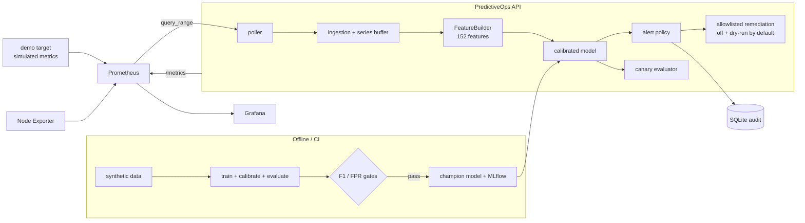

# PredictiveOps

Predictive failure detection and ML-driven deployment validation for containerized applications
(MCA Semester I minor project, JIMS Engineering Management Technical Campus).

PredictiveOps scores multivariate service metrics with a calibrated model that outputs the probability of a
failure within the next 15-30 minutes, turns that signal into sustained-risk alerts, optionally triggers
tightly constrained remediation, gates model promotion in CI, and judges canary releases against a baseline
with the same model.

> **Read this first.** All training and demo data is **synthetic** (`data_source = "synthetic"` everywhere).
> Results show the pipeline works under controlled conditions; they are **not** evidence that it predicts real
> production failures. The model detects almost nothing when a fault mechanism was absent from training (so keep
> threshold alerts too), and the canary only catches faults that begin before its decision point. Details and
> numbers: [`docs/evaluation.md`](docs/evaluation.md). `docker compose up` has not been executed by the author;
> see [Verification status](#verification-status).

## How it fits together



More detail (data flow, storage, leakage controls, API contracts): [`docs/architecture.md`](docs/architecture.md).
Synopsis requirement mapping: [`docs/requirements_traceability.md`](docs/requirements_traceability.md).

## Quick start (no Docker)

```bash
python -m venv .venv && source .venv/bin/activate
pip install -r requirements-dev.txt
python scripts/generate_data.py --days 14 --series 4 --seed 42 --out data/generated/synthetic.csv.gz
python scripts/train.py --promote            # trains, evaluates, enforces gates, sets the champion
uvicorn app.api.main:app_factory --factory --port 8000
```

Open http://localhost:8000 (legacy dashboard) or http://localhost:8000/docs (Swagger). The containerized stack uses the new React console. Then
`python scripts/demo_walkthrough.py` runs a narrated tour of every feature; [`docs/DEMO.md`](docs/DEMO.md) is the
presenter's guide.

`scripts/train.py` options: `--model-type {hgb,logreg,xgb}`, `--enforce-gates` (exit 2 when gates fail),
`--no-mlflow`, `--promote`. MLflow data lands in `artifacts/mlflow.db` (`mlflow ui --backend-store-uri sqlite:///artifacts/mlflow.db`).

## Full stack with Docker Compose

```bash
cp .env.example .env     # set TAILSCALE_IP and GRAFANA_ADMIN_PASSWORD
# Set it automatically to the server's Tailscale IPv4 address.
sed -i "s/^TAILSCALE_IP=.*/TAILSCALE_IP=$(tailscale ip -4)/" .env
# Keep .env private; generate a strong Grafana password.
docker compose up --build
```

| URL | What |
|---|---|
| http://TAILSCALE_IP:8000 | New PredictiveOps React console (FastAPI routes are reverse-proxied) |
| http://TAILSCALE_IP:3000 | Grafana infrastructure dashboard (`admin` / your password) |
| http://localhost:9090 | Prometheus (host-local only) |
| http://localhost:8001 | Demo target (host-local only) |

The one-shot `trainer` service generates data, trains, enforces the gates and promotes the model into a shared
volume; `api` starts only after it succeeds. The API polls Prometheus for the `demo-app` service and applies the
alert policy. The demo is **accelerated**: one 5-second step stands for one model "minute".

```bash
curl -X POST localhost:8001/fault -H "X-Admin-Token: $DEMO_ADMIN_TOKEN" -H 'content-type: application/json' \
     -d '{"fault_type":"memory_leak","ramp_minutes":30}'       # disabled unless DEMO_ADMIN_TOKEN is set
curl "http://$TAILSCALE_IP:8000/v1/alerts" ; curl "http://$TAILSCALE_IP:8000/v1/audit" ; curl "http://$TAILSCALE_IP:8000/v1/sources"
curl -X POST localhost:8001/fault/clear -H "X-Admin-Token: $DEMO_ADMIN_TOKEN"
docker compose --profile canary up -d     # second demo instance labelled as a canary
docker compose --profile mlflow up -d     # MLflow UI on :5000
```

Real container restarts are **opt-in** and read the security note first: `docker-compose.remediation.yml`
mounts the Docker socket (effectively root on the host).

The new React console is served by Nginx on port 8000; Nginx proxies `/v1/*`, `/health`, `/ready`, `/metrics`, and the API documentation to FastAPI. FastAPI is not published on a host port. Grafana is published only on the configured Tailscale address at port 3000. Prometheus and the demo target are bound to host loopback for local diagnostics. Node Exporter and cAdvisor provide host and container telemetry to Grafana. The demo target's resource metrics are *simulated*; the model does **not** consume Node Exporter or cAdvisor metrics. Using real metrics for model inference still requires changing the PromQL in `app/services/prometheus_client.py` and retraining on real data.

## API in brief

| Endpoint | Purpose |
|---|---|
| `GET /health`, `/ready` | liveness, readiness (503 until a model is loaded) |
| `GET /v1/model` | version, threshold, evaluation, data source |
| `POST /v1/predict` | score the latest sample from >= 30 contiguous 1-minute samples |
| `POST /v1/metrics/ingest` | buffer, score every new minute, run the alert policy (`X-API-Key` if configured) |
| `GET /v1/policy`, `POST /v1/policy/evaluate`, `GET /v1/alerts`, `GET /v1/audit` | policy state, preview, alerts, remediation audit |
| `POST /v1/canary/evaluate`, `GET /v1/canary[/{id}]` | canary decision and history (`X-API-Key` if configured) |
| `POST /v1/simulate`, `POST /v1/canary/simulate` | SYNTHETIC demos, no side effects |
| `GET /v1/series[/{id}]`, `GET /v1/sources`, `GET /metrics` | live series, poller status, Prometheus metrics |

```bash
curl localhost:8000/v1/model
curl -X POST localhost:8000/v1/simulate -H 'content-type: application/json' -d '{"fault_type":"memory_leak","seed":42}'
curl -X POST localhost:8000/v1/policy/evaluate -H 'content-type: application/json' \
     -d '{"probabilities":[0.9,0.9,0.9,0.9,0.9,0.9],"threshold":0.2}'
curl -X POST localhost:8000/v1/metrics/ingest -H 'content-type: application/json' -d '{"series_id":"checkout","samples":[{"timestamp":"2025-01-01T00:00:00Z","cpu_pct":20,"memory_pct":50,"disk_io_util_pct":10,"network_rx_mbps":4,"network_tx_mbps":6,"request_rate_rps":90,"latency_p95_ms":110,"error_rate":0.004}]}'
```
Ingestion rules: samples must be 1 minute apart; duplicates and out-of-order samples are rejected; a gap clears the
series history (features need regular spacing). Without a model the API still starts and prediction endpoints
return `model_not_ready`.

## Alert policy and safe remediation

| Level | Condition |
|---|---|
| none | probability below the model threshold |
| warn | at/above threshold, not yet sustained |
| alert | at/above threshold for `POLICY_SUSTAIN_ALERT` consecutive minutes (default 3) |
| remediate | at/above `max(0.80, threshold)` for `POLICY_SUSTAIN_REMEDIATE` minutes (default 5) |

Remediation passes these gates in order: a configured target for the series, an action allowlist
(`restart_container`, `rollback_canary` only), the master switch (**off by default**), a per-target cooldown
(900 s), an hourly cap (4), dry-run (**on by default**), and in live mode a container carrying the label
`predictiveops.managed=true` (`rollback_canary` also needs `predictiveops.role=canary`). Nothing can run an arbitrary
command. Cooldowns and caps are read from the SQLite audit log, so they survive restarts; every outcome is audited.
To try a dry run: `PREDICTIVEOPS_REMEDIATION_ENABLED=true` and
`PREDICTIVEOPS_REMEDIATION_TARGETS={"demo-live":{"container":"my-app","action":"restart_container"}}`.

## Canary validation

`POST /v1/canary/evaluate` takes baseline and candidate samples for a named `service`; the same model scores both and
only overlapping minutes are compared. Defaults (override with `PREDICTIVEOPS_CANARY` JSON): **hold** with fewer than
20 scored minutes or inconclusive evidence; **rollback** for 5 consecutive minutes at >= 80 % risk while the baseline is
not, or >= 30 % alerting minutes with mean risk >= 10 points above baseline; **promote** for <= 5 % alerting minutes
and mean risk within 5 points of baseline. A rollback uses the same gated, audited path as remediation, and the
container comes only from `PREDICTIVEOPS_CANARY_TARGETS`; the request can never name one. **A regression that
starts after the decision is promoted.** Use `{"min_observation_minutes": 60}` or longer outside demos.

## Configuration (environment, prefix `PREDICTIVEOPS_`, see `.env.example`)

| Group | Variables |
|---|---|
| Core | `ENV`, `LOG_LEVEL`, `LOG_JSON`, `DATA_DIR`, `SQLITE_PATH`, `MODEL_DIR`, `HORIZON_MINUTES` (15-30), `SYNTHETIC_SEED`, `INGEST_BUFFER_MINUTES` |
| MLflow and gates | `MLFLOW_TRACKING_URI`, `MLFLOW_EXPERIMENT`, `MLFLOW_MODEL_NAME`, `GATE_MIN_F1` (0.70), `GATE_MAX_FPR` (0.05) |
| Security | `API_KEY` (protects ingest and canary evaluate when set; empty values are ignored) |
| Prometheus polling | `PROMETHEUS_ENABLED`, `PROMETHEUS_URL`, `PROMETHEUS_SERVICES`, `PROMETHEUS_STEP_SECONDS`, `PROMETHEUS_POLL_SECONDS`, `PROMETHEUS_LOOKBACK_STEPS` |
| Policy and remediation | `POLICY_SUSTAIN_ALERT`, `POLICY_SUSTAIN_REMEDIATE`, `POLICY_REMEDIATE_THRESHOLD`, `REMEDIATION_ENABLED`, `DRY_RUN`, `REMEDIATION_TARGETS` (JSON), `REMEDIATION_COOLDOWN_SECONDS`, `MAX_ACTIONS_PER_HOUR` |
| Canary | `CANARY` (JSON), `CANARY_TARGETS` (JSON) |

Secrets are only ever read from the environment or GitHub secrets; required ones (Grafana password) have no default.

## Testing and CI

```bash
pytest -o addopts=""                                   # ~3.5 min on one core: unit, integration, MLflow, API
pytest -m e2e -o addopts="" tests/e2e                  # real processes; needs PROMETHEUS_BIN (+ NODE_EXPORTER_BIN, Playwright)
ruff check .
python scripts/canary_smoke.py --seeds 20              # CI-style regression check of the champion + canary
python scripts/evaluate_robustness.py                  # seed variability, held-out fault, canary study (~10 min)
```

`.github/workflows/ci.yml` runs lint, tests and validates compose, Prometheus config, images and the Dockerfile.
`ml-gates.yml` trains, enforces F1 / false-positive-rate gates and the canary smoke test, and uploads the champion
artifact only if everything passes (optional remote MLflow registration through repository secrets).

## Repository layout

| Path | Purpose |
|---|---|
| `app/core`, `app/models` | settings, logging, domain definitions; schemas, model bundle, registry, predictor |
| `app/features` | `FeatureBuilder` (backward-looking features, hashed schema shared by training and inference) |
| `app/api`, `app/static` | FastAPI app, routers, ingestion, poller; legacy fallback dashboard |
| `frontend` | React + TypeScript console, Vite build, Nginx reverse proxy |
| `app/services` | series buffer, Prometheus client, canary logic and simulation |
| `app/policies` | policy engine, allowlisted actions, SQLite audit store |
| `data/synthetic` | reproducible simulator, labelling, scenarios |
| `training` | split, baseline, calibration, evaluation, gates, MLflow, robustness studies |
| `demo_app` | demo target with SIMULATED metrics and token-protected fault injection |
| `docker`, `docker-compose*.yml`, `prometheus`, `monitoring`, `grafana`, `.github/workflows` | image, stack, scrape config, alert rules, dashboards, CI |
| `scripts` | generate data, train, evaluate, canary smoke, gate report, demo walkthrough |
| `tests` | `unit/`, `integration/`, `e2e/` |
| `docs` | architecture, evaluation, traceability, demo guide |

## Verification status

| Verified (executed) | Not executed |
|---|---|
| Full test suite (160+ tests, 99 % coverage), clean-venv run, runtime-only venv | `docker build` / `docker compose up` / pulling pinned images |
| Live end-to-end on native processes: real Prometheus 3.5.0 + node_exporter + demo target + API poller | Grafana rendering the provisioned dashboard (its PromQL was executed) |
| Browser tests of the dashboard (Playwright/Chromium) | GitHub Actions runs |
| `promtool`, `hadolint`, workflow and compose schema checks | Real container restart or canary stop through Docker |

## Known limitations

* Synthetic data only; no evidence on real systems. Metrics come from the project's own simulator.
* Unseen fault mechanisms are missed by the model (held-out: memory leak 2/97, error ramp 2/103 events); thresholds catch them.
* The canary decides once, after its minimum observation period; later regressions are promoted.
* The model does not consume Node Exporter metrics; real data requires new queries and retraining.
* The demo clock is accelerated; the poller, policy counters and series buffers are in memory (single process).
* No Alertmanager, no Kubernetes, no multi-service dependency modelling (out of scope per the synopsis).
