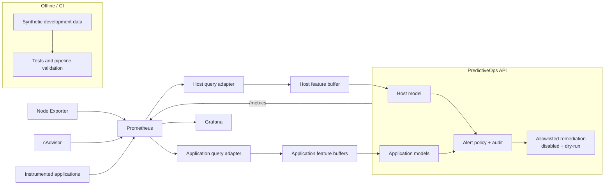

# PredictiveOps

Predictive failure detection for two independent scopes: whole-host resource exhaustion and per-application degradation. The platform combines Prometheus telemetry, calibrated ML inference, alert policy, audit history and Grafana observability.

PredictiveOps scores multivariate service metrics with a calibrated model that outputs the probability of a
failure within the next 15-30 minutes, turns that signal into sustained-risk alerts, optionally triggers
tightly constrained remediation, gates model promotion in CI, and judges canary releases against a baseline
with the same model.

> **Production safety:** synthetic data is for development and CI only. Production inference rejects synthetic-only
> models and models without passing evaluation gates. These controls are **not** evidence of production accuracy; only evaluation on reviewed real incidents can establish that. A production deployment requires a separately trained host model and, when application targets are configured,
> a separately trained application model, each backed by reviewed real incident labels. Until every configured
> scope is available and passes its gates, `/ready` returns HTTP 503 and the dashboard reports the exact blocker. See
> [the production telemetry contract](docs/production-telemetry.md).

## How it fits together



More detail (data flow, storage, leakage controls, API contracts): [`docs/architecture.md`](docs/architecture.md).
Synopsis requirement mapping: [`docs/requirements_traceability.md`](docs/requirements_traceability.md).
Evaluation methodology and release gates: [`docs/evaluation.md`](docs/evaluation.md).

## Quick start (no Docker)

```bash
python -m venv .venv && source .venv/bin/activate
pip install -r requirements-dev.txt
python scripts/generate_data.py --days 14 --series 4 --seed 42 --out data/generated/synthetic.csv.gz
python scripts/train.py --promote            # trains, evaluates, enforces gates, sets the champion
uvicorn app.api.main:app_factory --factory --port 8000
```

Open http://localhost:8000 (legacy dashboard) or http://localhost:8000/docs (Swagger). The containerized stack uses the new React console. Then
`python scripts/demo_walkthrough.py` runs a narrated tour of every feature; [`docs/DEMO.md`](docs/DEMO.md) is the
presenter's guide.

`scripts/train.py` options: `--model-type {hgb,logreg,xgb}`, `--enforce-gates` (exit 2 when gates fail),
`--no-mlflow`, `--promote`. MLflow data lands in `artifacts/mlflow.db` (`mlflow ui --backend-store-uri sqlite:///artifacts/mlflow.db`).

## Production stack with Docker Compose

The production Compose stack contains the API, React console, Prometheus, Node Exporter,
cAdvisor and Grafana. It contains **no demo application or canary containers**. Host telemetry
is collected automatically. Application telemetry is opt-in per service through Prometheus
file-based discovery.

### 1. Prepare labelled training data

Create two one-minute datasets and place them in the ignored local `training-data/` directory:

- `training-data/host.csv.gz` — host metrics and host incident labels.
- `training-data/application.csv.gz` — application metrics and application incident labels.

The datasets must include the scope's metric columns, `timestamp`, `series_id`,
`is_unhealthy`, and a truthful `data_source` provenance value. Labels must be derived from
reviewed incident/impact records or an explicitly documented operational definition. See
[production telemetry and training requirements](docs/production-telemetry.md). Do not label
synthetic data as production.

### 2. Train and promote both models

```bash
cp .env.example .env
# Set TAILSCALE_IP and a strong GRAFANA_ADMIN_PASSWORD in .env.
mkdir -p training-data
# Place host.csv.gz and application.csv.gz in training-data/.
docker compose --profile training run --build --rm trainer
```

The trainer evaluates each scope independently and promotes only if its quality gates pass.
It writes champions under `artifacts/models/host` and `artifacts/models/application`.
Training is an explicit operation; Compose never generates or promotes synthetic models
during API startup.

### 3. Configure application discovery

For each application, expose the metrics contract in
[`docs/production-telemetry.md`](docs/production-telemetry.md), apply the Docker label
`predictiveops.service=<service>`, and add its scrape target to
`prometheus/targets/applications.yml`:

```yaml
- targets: ["your-app:8000"]
  labels:
    service: your-app
    environment: production
```

Set the matching comma-separated service names in
`PREDICTIVEOPS_PROMETHEUS_APPLICATION_SERVICES` in `.env`. The app target and configured
service name must match exactly.

### 4. Start the stack

```bash
docker compose up --build -d
docker compose ps
curl -i "http://$TAILSCALE_IP:8000/ready"
```

Prometheus scrapes at 15-second intervals; the prediction pipeline samples one-minute
windows. The host and application models remain separate. Both must pass production
eligibility checks before readiness becomes healthy. The first prediction for a new series
requires the model's full contiguous feature history.

| URL | Purpose |
|---|---|
| http://TAILSCALE_IP:8000 | React console |
| http://TAILSCALE_IP:3000 | Grafana |
| http://localhost:9090 | Prometheus, if published locally by your deployment |
| http://TAILSCALE_IP:8000/docs | API documentation |

Prometheus application targets are discovered from the mounted
`prometheus/targets/applications.yml`. Node Exporter and cAdvisor provide host/container
telemetry. Application latency and error-rate alerts use the standard
`predictiveops_app_*` metric contract.

Remediation stays disabled and dry-run by default. Do not mount the Docker socket or enable
live remediation until its target allowlist and action path have been reviewed.

## API in brief

| Endpoint | Purpose |
|---|---|
| `GET /health`, `GET /ready` | Liveness and readiness; production requires both qualified scope models |
| `GET /v1/model` | Model metadata; production returns separate host and application models |
| `GET /v1/sources` | Prometheus source and per-scope poller status |
| `GET /v1/live-forecast` | Live 15/30-minute host resource guardrail forecast from Node Exporter telemetry |
| `GET /v1/experimental/host/prediction` | Read-only synthetic-trained HGB score over live host telemetry; experimental and not production-qualified |
| `GET /v1/series[/{id}]` | Buffered time series and latest prediction state |
| `GET /v1/alerts`, `GET /v1/audit`, `GET /v1/policy` | Alert history, audit log and policy state |
| `GET /metrics` | PredictiveOps Prometheus instrumentation |
| `POST /v1/predict`, `POST /v1/metrics/ingest` | Legacy combined-model development endpoints; not used by production scope pollers |
| `POST /v1/simulate`, canary routes | Development-only; not registered when `ENV=production` |

The production API polls host metrics and configured application targets independently. A series
needs at least the model's required contiguous one-minute history before the first supervised prediction.
Missing exporters, missing metrics, stale samples and unqualified models are reported as source or
readiness failures; they are never converted into a healthy zero-valued prediction.

### Experimental ML score on live host telemetry

For a live ML demonstration without pretending synthetic labels are real incidents, train an isolated
host-scope model from host-only synthetic CPU, memory and disk fault scenarios, then score the actual
Node Exporter metrics buffered by Prometheus. The model lives under
`artifacts/models/experimental-host`; it never replaces the production host or application champion.

```bash
docker compose build trainer api frontend
docker compose run --rm --no-deps trainer python scripts/train_experimental_host.py
docker compose up -d --no-deps api frontend
```

The script evaluates the model on a chronological held-out synthetic test segment and reports its gates.
It installs the artifact only in the isolated experimental directory, even if a gate fails; the gate result
remains visible in the dashboard. The experimental endpoint requires 30 contiguous one-minute live host
samples and has no alert-policy or remediation side effects.

**Interpretation:** this is synthetic training applied to real host inputs. Its probability is not evidence
of real-world calibration or production failure accuracy. The separate live resource forecast panel uses
a robust Theil-Sen trend estimator to project CPU, memory and disk guardrail crossings; that is a capacity
forecast, not a failure probability. Both are observational signals. Production ML qualification still
requires representative labelled real incidents and independent validation.

## Alert policy and safe remediation

| Level | Condition |
|---|---|
| none | probability below the model threshold |
| warn | at/above threshold, not yet sustained |
| alert | at/above threshold for `POLICY_SUSTAIN_ALERT` consecutive minutes (default 3) |
| remediate | at/above `max(0.80, threshold)` for `POLICY_SUSTAIN_REMEDIATE` minutes (default 5) |

Remediation passes these gates in order: a configured target for the series, an action allowlist
(`restart_container`, `rollback_canary` only), the master switch (**off by default**), a per-target cooldown
(900 s), an hourly cap (4), dry-run (**on by default**), and in live mode a container carrying the label
`predictiveops.managed=true` (`rollback_canary` also needs `predictiveops.role=canary`). Nothing can run an arbitrary
command. Cooldowns and caps are read from the SQLite audit log, so they survive restarts; every outcome is audited.
Production remediation targets are empty by default. Add a reviewed service-to-container mapping
only after confirming the target's `predictiveops.managed=true` label. Keep dry-run enabled until
the action has been tested against a disposable container.

## Canary validation (development only)

Canary simulation routes are not registered in production mode. `POST /v1/canary/evaluate` takes baseline and candidate samples for a named `service`; the same model scores both and
only overlapping minutes are compared. Defaults (override with `PREDICTIVEOPS_CANARY` JSON): **hold** with fewer than
20 scored minutes or inconclusive evidence; **rollback** for 5 consecutive minutes at >= 80 % risk while the baseline is
not, or >= 30 % alerting minutes with mean risk >= 10 points above baseline; **promote** for <= 5 % alerting minutes
and mean risk within 5 points of baseline. A rollback uses the same gated, audited path as remediation, and the
container comes only from `PREDICTIVEOPS_CANARY_TARGETS`; the request can never name one. **A regression that
starts after the decision is promoted.** Use `{"min_observation_minutes": 60}` or longer outside demos.

## Configuration (environment, prefix `PREDICTIVEOPS_`, see `.env.example`)

| Group | Variables |
|---|---|
| Core | `ENV`, `LOG_LEVEL`, `LOG_JSON`, `DATA_DIR`, `SQLITE_PATH`, `MODEL_DIR`, `HORIZON_MINUTES` (15-30), `SYNTHETIC_SEED`, `INGEST_BUFFER_MINUTES` |
| MLflow and gates | `MLFLOW_TRACKING_URI`, `MLFLOW_EXPERIMENT`, `MLFLOW_MODEL_NAME`, `GATE_MIN_F1` (0.70), `GATE_MAX_FPR` (0.05) |
| Security | `API_KEY` (protects write endpoints when set; empty values are ignored) |
| Prometheus polling | `PROMETHEUS_ENABLED`, `PROMETHEUS_URL`, `PROMETHEUS_HOST_SERIES_ID`, `PROMETHEUS_APPLICATION_SERVICES`, `PROMETHEUS_STEP_SECONDS`, `PROMETHEUS_POLL_SECONDS`, `PROMETHEUS_LOOKBACK_STEPS` |
| Policy and remediation | `POLICY_SUSTAIN_ALERT`, `POLICY_SUSTAIN_REMEDIATE`, `POLICY_REMEDIATE_THRESHOLD`, `REMEDIATION_ENABLED`, `DRY_RUN`, `REMEDIATION_TARGETS` (JSON), `REMEDIATION_COOLDOWN_SECONDS`, `MAX_ACTIONS_PER_HOUR` |
| Development compatibility | `PROMETHEUS_SERVICES` (legacy combined-model polling; never use in production) |

Secrets are only ever read from the environment or GitHub secrets; required ones (Grafana password) have no default.

## Testing and CI

```bash
pytest -o addopts=""                                   # ~3.5 min on one core: unit, integration, MLflow, API
pytest -m e2e -o addopts="" tests/e2e                  # real processes; needs PROMETHEUS_BIN (+ NODE_EXPORTER_BIN, Playwright)
ruff check .
python scripts/canary_smoke.py --seeds 20              # CI-style regression check of the champion + canary
python scripts/evaluate_robustness.py                  # seed variability, held-out fault, canary study (~10 min)
```

`.github/workflows/ci.yml` runs lint, tests and validates compose, Prometheus config, images and the Dockerfile.
`ml-gates.yml` trains, enforces F1 / false-positive-rate gates and the canary smoke test, and uploads the champion
artifact only if everything passes (optional remote MLflow registration through repository secrets).

## Repository layout

| Path | Purpose |
|---|---|
| `app/core`, `app/models` | settings, logging, domain definitions; schemas, model bundle, registry, predictor |
| `app/features` | `FeatureBuilder` (backward-looking features, hashed schema shared by training and inference) |
| `app/api`, `app/static` | FastAPI app, routers, ingestion, poller; legacy fallback dashboard |
| `frontend` | React + TypeScript console, Vite build, Nginx reverse proxy |
| `app/services` | series buffer, Prometheus client, canary logic and simulation |
| `app/policies` | policy engine, allowlisted actions, SQLite audit store |
| `data/synthetic` | reproducible simulator, labelling, scenarios |
| `training` | split, baseline, calibration, evaluation, gates, MLflow, robustness studies |
| `demo_app` | demo target with SIMULATED metrics and token-protected fault injection |
| `docker`, `docker-compose*.yml`, `prometheus`, `monitoring`, `grafana`, `.github/workflows` | image, stack, scrape config, alert rules, dashboards, CI |
| `scripts` | generate data, train, evaluate, canary smoke, gate report, demo walkthrough |
| `tests` | `unit/`, `integration/`, `e2e/` |
| `docs` | architecture, evaluation, traceability, demo guide |

## Verification status

This production-hardening branch has not yet been released or deployed. GitHub Actions validation
is being run against the latest commits; the full CI result must be green before deployment.
The existing prototype's prior tests and native-process checks do not validate the new dual-scope
production stack. Docker Compose deployment, Grafana rendering, real host polling, and real
application instrumentation still require an end-to-end run on the target server.

## Known limitations and release blockers

- Real, reviewed, labelled host and application datasets have not yet been supplied. Production
  readiness deliberately remains HTTP 503 until the host model and every configured application model are trained
  from non-synthetic data and pass their evaluation gates.
- Each application must expose the documented request counter and latency histogram, and its
  container must carry the `predictiveops.service` label. Uninstrumented applications are not
  eligible for application-level inference.
- The current prediction buffers are process-local and are rebuilt from Prometheus history after
  restart. Keep Prometheus retention longer than the poller's lookback window.
- No Alertmanager, Kubernetes integration, or multi-service dependency modelling is included.
- Live remediation remains disabled and dry-run by default; do not enable it without a separate
  security review and disposable-target test.

* Unseen fault mechanisms are missed by the model (held-out: memory leak 2/97, error ramp 2/103 events); thresholds catch them.
* The canary decides once, after its minimum observation period; later regressions are promoted.
* The model does not consume Node Exporter metrics; real data requires new queries and retraining.
* The demo clock is accelerated; the poller, policy counters and series buffers are in memory (single process).
* No Alertmanager, no Kubernetes, no multi-service dependency modelling (out of scope per the synopsis).
