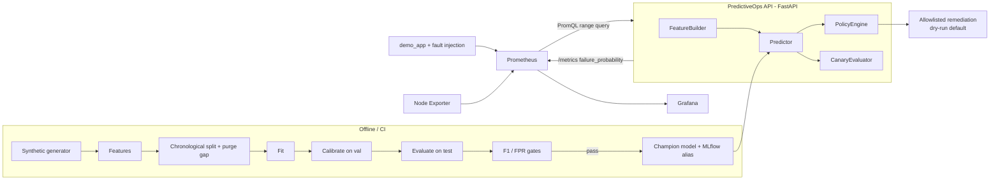

# PredictiveOps — Architecture

> Status: all components below are built and tested (Docker-based pieces are validated statically and on native
> processes, not executed under Docker; see `PROJECT_STATUS.md`).

## 1. Data flow



## 2. Components and responsibilities

| Module | Responsibility | State |
|---|---|---|
| `app/core` | settings, logging, exceptions, `METRIC_COLUMNS`, definition of "unhealthy" | built |
| `app/features` | `FeatureBuilder`: 152 backward-looking features, versioned schema + hash | built |
| `app/models` | schemas, `ModelBundle` (estimator + calibrator + threshold + schema), file registry, `Predictor` | built |
| `data/synthetic` | reproducible simulator with ground-truth labels | built |
| `training` | split, baseline, calibration, evaluation, gates, MLflow tracking, pipeline | built |
| `app/api`, `app/static` | FastAPI service and dashboard; `app/services/series_buffer.py` live buffer | built |
| `app/policies` | `PolicyEngine` (sustained-level alerting + gated remediation), `AuditStore` (SQLite), allowlisted `DockerExecutor` | built |
| `app/services/canary*.py` | `assess` (pure decision function), `CanaryEvaluator`, `CanaryService` (persist + gated rollback) | built |
| `app/services/prometheus_client.py`, `app/api/{ingestion,poller}.py` | Prometheus query client, shared ingestion path, background poller | built |
| `demo_app` | demo target with SIMULATED metrics + fault injection | built |

## 3. Storage strategy

* **Prometheus** is the time-series store. **SQLite** holds application metadata: alerts, audit log, canary runs (WAL mode, single connection + lock; single-process).
* **Model artifacts:** `artifacts/models/<version>/{model.joblib, metadata.json}` plus `champion.json` (atomic pointer swap). joblib files are pickles — load only artifacts produced by this pipeline.
* **MLflow:** SQLite backend `artifacts/mlflow.db`, artifacts in `artifacts/mlartifacts/`. Each run logs params, metrics, `evaluation_report.json`, the bundle, and a pyfunc model registered as `predictiveops-failure-model`; alias `champion` is set only when gates pass.

## 4. Training / inference parity guarantees

1. One `FeatureBuilder` produces features for both paths; the ordered name list and config are hashed (`schema_hash`) and stored with the model.
2. `ModelBundle.load` recomputes the hash from current code and raises `ModelSchemaMismatchError` on mismatch.
3. Tests assert (a) no look-ahead (altering future samples leaves earlier features unchanged), (b) batch features == `transform_last` on a truncated window, (c) `Predictor.predict` == batch scoring.

## 5. Evaluation protocol (leakage control)

* Chronological split by global timestamp: 60 % train / 20 % validation / 20 % test.
* A **purge gap** of H minutes is removed before each boundary so no training/validation label looks into the next segment.
* Rows already unhealthy, rows with incomplete horizon, and feature warm-up rows are excluded.
* Class imbalance: class weights (`balanced` / `scale_pos_weight`). Calibration (sigmoid or isotonic, chosen by out-of-sample Brier within validation) is fitted on validation only. The decision threshold maximises F1 subject to FPR ≤ cap on validation only. Test is used once, for reporting and gates.
* Reported: precision, recall, F1, FPR, PR-AUC, ROC-AUC, Brier (vs prevalence Brier), ECE and a calibration curve, event-level recall and lead time, and two static-threshold baselines (default warning levels; scale tuned on validation).

## 5b. Deployment topology

```
trainer (one-shot: data -> train -> gates -> champion)  --volume artifacts-->  api
demo-app (SIMULATED gauges, /work, fault injection) --scrape--> Prometheus <--scrape-- node-exporter, api
Prometheus --query_range (step = one model minute)--> api poller --> ingestion --> alert policy --> SQLite audit
api /metrics --> Prometheus --> Grafana (provisioned datasource + dashboard)
```
* One image (`docker/Dockerfile`, targets `runtime` and `trainer`) runs as a non-root user with a healthcheck.
* Default stack mounts **no** Docker socket; real remediation is only possible through the opt-in `docker-compose.remediation.yml`.
* The poller maps each scrape step to a logical 1-minute sample with a stable timestamp (`floor(ts/step)*60`) so repeated polls never double-count and accelerated demos satisfy the model's regular-spacing requirement. Missing scrapes become gaps that clear the buffer, never interpolated values.
* Service names used in PromQL are validated against a strict pattern before substitution (no PromQL injection).

## 6. API contracts (v1)

| Method and path | Purpose | Auth |
|---|---|---|
| `GET /health`, `GET /ready` | liveness; readiness (503 until a champion model is loaded) | none |
| `GET /v1/model` | version, type, threshold, evaluation summary, data source, disclaimer | none |
| `POST /v1/predict` | score the latest sample of one service from >= 30 contiguous 1-minute samples | none |
| `POST /v1/metrics/ingest` | buffer samples, score every new minute, run the alert policy | `X-API-Key` if configured |
| `GET /v1/series`, `GET /v1/series/{id}` | buffered series, latest prediction, policy level | none |
| `GET /v1/sources` | Prometheus poller status | none |
| `GET /v1/policy`, `POST /v1/policy/evaluate` | active policy + live state; side-effect-free preview | none |
| `GET /v1/alerts`, `GET /v1/audit` | alert events; every remediation decision | none |
| `POST /v1/canary/evaluate` | baseline vs candidate decision; gated rollback via configured target | `X-API-Key` if configured |
| `GET /v1/canary`, `GET /v1/canary/{id}` | stored canary runs | none |
| `POST /v1/simulate`, `POST /v1/canary/simulate` | SYNTHETIC demos; no side effects | none |
| `GET /metrics` | Prometheus exposition | none |
| `GET /`, `GET /docs` | dashboard; Swagger UI | none |

Errors are JSON `{"error": code, "detail": text}`: 422 `invalid_data` / `invalid_scenario`, 503 `model_not_ready`,
401 for a bad API key, 404 for unknown series/runs, 500 `internal_error`. Every response carries `x-request-id`;
requests are logged as structured JSON. `POST /v1/predict` returns `PredictionResult`
(`probability, threshold, predicted_failure, horizon_minutes, model_version, data_source, as_of`).

## 7. Key decisions

* Synthetic data is labelled as such everywhere (column, metadata sidecar, model metadata, CLI output).
* Gradient boosting (sklearn HGB default; XGBoost optional) with logistic regression as a linear reference.
* Remediation is allowlist-only, off by default, dry-run by default, with cooldowns, an hourly cap and an audit trail; no shell execution. Gate order: target configured -> action allowlisted -> master switch -> cooldown -> hourly cap -> dry-run -> execute (label-verified container). An executed/dry-run action resets the series' counters so a new action needs fresh evidence; blocked outcomes do not, so the action fires as soon as a cooldown ends if risk is still high.
* Canary: decisions are relative (candidate vs baseline on overlapping minutes), asymmetric (promotion needs positive evidence, rollback needs clear evidence, everything else holds), and the minimum observation period is enforced for both outcomes. Rollback reuses `PolicyEngine.request_action`, so it shares the allowlist, master switch, cooldown, hourly cap, dry-run and audit trail with remediation; the target is looked up from configuration by service name and the request cannot supply a container.
* Policy replay for the dashboard uses a throw-away engine (in-memory audit, forced dry-run), so demos never touch the real audit log.
* Docker, Compose, Grafana and GitHub Actions files are validated statically (promtool, hadolint, schemas, invariant tests); Prometheus, node_exporter, the API and the demo target were run end to end as native processes. `docker compose up` itself has not been executed by the author.
