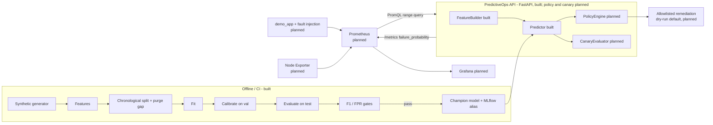

# PredictiveOps — Architecture (Phase 2)

> Status: components marked **[built]** exist and are tested; **[planned]** are later phases.

## 1. Data flow

## 2. Components and responsibilities

| Module | Responsibility | State |
|---|---|---|
| `app/core` | settings, logging, exceptions, `METRIC_COLUMNS`, definition of "unhealthy" | built |
| `app/features` | `FeatureBuilder`: 152 backward-looking features, versioned schema + hash | built |
| `app/models` | schemas, `ModelBundle` (estimator + calibrator + threshold + schema), file registry, `Predictor` | built |
| `data/synthetic` | reproducible simulator with ground-truth labels | built |
| `training` | split, baseline, calibration, evaluation, gates, MLflow tracking, pipeline | built |
| `app/api`, `app/static` | FastAPI service and dashboard; `app/services/series_buffer.py` live buffer | built |
| `app/policies` | `PolicyEngine` (sustained-level alerting + gated remediation), `AuditStore` (SQLite), allowlisted `DockerExecutor` | built |
| `app/services` (Prometheus client, canary) | planned |

## 3. Storage strategy

* **Prometheus** is the time-series store (planned). **SQLite** holds application metadata: alerts, audit log, canary runs (planned).
* **Model artifacts:** `artifacts/models/<version>/{model.joblib, metadata.json}` plus `champion.json` (atomic pointer swap). joblib files are pickles — load only artifacts produced by this pipeline.
* **MLflow:** SQLite backend `artifacts/mlflow.db`, artifacts in `artifacts/mlartifacts/`. Each run logs params, metrics, `evaluation_report.json`, the bundle, and a pyfunc model registered as `predictiveops-failure-model`; alias `champion` is set only when gates pass.

## 4. Training / inference parity guarantees

1. One `FeatureBuilder` produces features for both paths; the ordered name list and config are hashed (`schema_hash`) and stored with the model.
2. `ModelBundle.load` recomputes the hash from current code and raises `ModelSchemaMismatchError` on mismatch.
3. Tests assert (a) no look-ahead (altering future samples leaves earlier features unchanged), (b) batch features == `transform_last` on a truncated window, (c) `Predictor.predict` == batch scoring.

## 5. Evaluation protocol (leakage control)

* Chronological split by global timestamp: 60 % train / 20 % validation / 20 % test.
* A **purge gap** of H minutes is removed before each boundary so no training/validation label looks into the next segment.
* Rows already unhealthy, rows with incomplete horizon, and feature warm-up rows are excluded.
* Class imbalance: class weights (`balanced` / `scale_pos_weight`). Calibration (sigmoid or isotonic, chosen by out-of-sample Brier within validation) is fitted on validation only. The decision threshold maximises F1 subject to FPR ≤ cap on validation only. Test is used once, for reporting and gates.
* Reported: precision, recall, F1, FPR, PR-AUC, ROC-AUC, Brier (vs prevalence Brier), ECE and a calibration curve, event-level recall and lead time, and two static-threshold baselines (default warning levels; scale tuned on validation).

## 6. API contracts (v1)

**Implemented (Phase 5):** `GET /health`, `GET /ready`, `GET /v1/model`, `POST /v1/predict`,
`POST /v1/metrics/ingest` (optional `X-API-Key`), `GET /v1/series`, `GET /v1/series/{id}`,
`POST /v1/simulate` (synthetic demo scoring), `GET /metrics`, dashboard at `/`, Swagger at `/docs`.
Errors are JSON `{"error": code, "detail": text}`: 422 `invalid_data` / `invalid_scenario`, 503 `model_not_ready`.
Every response carries `x-request-id`; requests are logged as structured JSON.

**Implemented (Phase 6):** `GET /v1/policy`, `POST /v1/policy/evaluate` (side-effect-free preview), `GET /v1/alerts`, `GET /v1/audit`; `POST /v1/metrics/ingest` now returns the policy `decision`.

**Planned:** `POST /v1/canary/evaluate`, `GET /v1/canary/{id}`.

Original list for reference:

`GET /health`, `GET /ready`, `POST /v1/predict`, `POST /v1/metrics/ingest`, `GET /v1/model`,
`GET /v1/policy`, `POST /v1/policy/evaluate`, `GET /v1/audit`, `POST /v1/canary/evaluate`,
`GET /v1/canary/{id}`, `GET /metrics`. `POST /v1/predict` returns `PredictionResult`
(`probability, threshold, predicted_failure, horizon_minutes, model_version, data_source, as_of`).

## 7. Key decisions

* Synthetic data is labelled as such everywhere (column, metadata sidecar, model metadata, CLI output).
* Gradient boosting (sklearn HGB default; XGBoost optional) with logistic regression as a linear reference.
* Remediation is allowlist-only, off by default, dry-run by default, with cooldowns, an hourly cap and an audit trail; no shell execution. Gate order: target configured -> action allowlisted -> master switch -> cooldown -> hourly cap -> dry-run -> execute (label-verified container). An executed/dry-run action resets the series' counters so a new action needs fresh evidence; blocked outcomes do not, so the action fires as soon as a cooldown ends if risk is still high.
* Policy replay for the dashboard uses a throw-away engine (in-memory audit, forced dry-run), so demos never touch the real audit log.
* Docker/Compose/Prometheus/Grafana/GitHub Actions (Phase 8) cannot be executed in the current sandbox and will be reported as "written, not executed".
